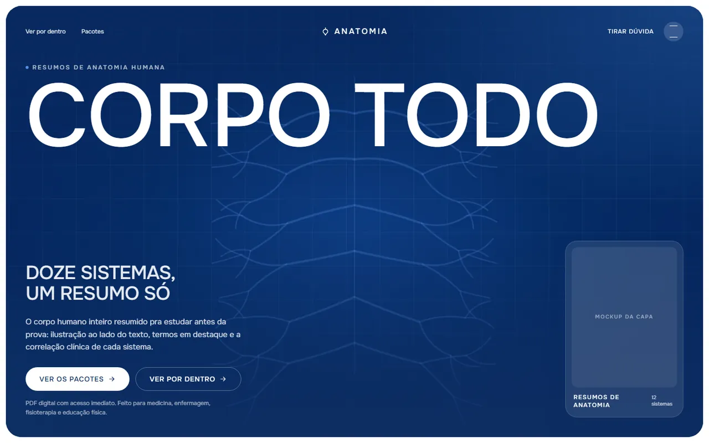
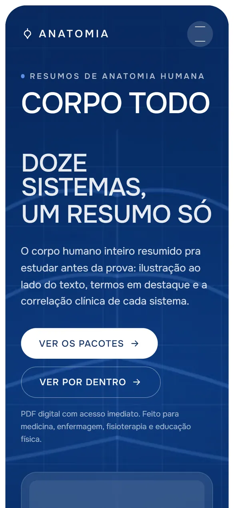

<div align="center">

# Land Page Basic

**Uma base de landing page em arquivo único, com motor de animação próprio, adaptada para três páginas: o modelo original, um clube de tênis e uma página de vendas de resumos de anatomia.**


</div>

<p align="center">
  
  
</p>

## Sobre

Este repositório guarda um estudo de reaproveitamento de layout. Um modelo de landing page em inglês
(o "Baseline", um clube e academia de tênis) foi traduzido e reescrito em pt-BR e, depois, adaptado
para um produto bem diferente: um material de resumos de anatomia humana para estudantes da saúde.

As três páginas dividem o mesmo esqueleto: um arquivo HTML só, com CSS e JavaScript embutidos, sem
build, e o mesmo motor de animação (molas em `requestAnimationFrame`, paralaxe, revelação palavra por
palavra e rolagem suave com Lenis).

| Arquivo | O que é |
| --- | --- |
| `index.html` | **Resumos de Anatomia**: página de vendas de um material em PDF com os doze sistemas do corpo humano (a página principal) |
| `tenis-clube.html` | **Baseline, Clube e Academia de Tênis**: a versão em pt-BR, reescrita para aulas com plano de progressão |
| `landing-original.html` | **Baseline, Tennis Club & Academy**: o modelo original em inglês, mantido como referência |

## Destaques

- **Tipografia que escala com a tela.** `scaleRoot()` recalcula o `font-size` da raiz a partir de uma
  largura base de 1920px: o layout inteiro, escrito em `rem`, cresce junto em monitores grandes.
- **Molas sem biblioteca.** Um helper próprio de mola (tensão e atrito) roda num único laço de
  `requestAnimationFrame` e anima opacidade e deslocamento de cada bloco.
- **Títulos revelados palavra por palavra**, com máscara de recorte em cada palavra e entrada escalonada.
- **Paralaxe por seção** e respostas em mola ao passar o mouse ou focar com o teclado.
- **Rolagem suave com Lenis**, carregada por `importmap` do jsDelivr. Se a importação falhar, a página
  segue com a rolagem nativa. Menu e modal travam a rolagem do fundo enquanto estão abertos.
- **Tela de carregamento** com marca e barra de progresso, com tempo mínimo e máximo na tela.
- **Menu em sobreposição e modal "Tirar dúvida"**, ambos como `role="dialog"` com `aria-modal`,
  fechando com Esc. O modal traz um formulário de dúvida com tela de confirmação.
- **Carrossel de sistemas** (na página de anatomia) e de treinadores (na de tênis), com setas, bolinhas
  e troca animada.
- **Reduzir movimento.** Com `prefers-reduced-motion`, as revelações aparecem prontas e o vídeo do hero
  para no primeiro quadro, que já mostra o desenho inteiro.
- **Botões de compra com rede de segurança.** Enquanto o link de checkout for `#`, o clique abre o
  modal de dúvida em vez de quebrar a navegação.

## Seções da página de anatomia (`index.html`)

1. **Carregamento**: marca "Anatomia" e barra de progresso.
2. **Hero**: vídeo de fundo com o desenho anatômico, "Corpo todo", "Doze sistemas, um resumo só" e mockup da capa.
3. **Método** (`#metodo`): por que o material foi montado na ordem em que se estuda.
4. **Como você usa** (`#como`): ciclo de estudo em quatro passos, indicando o que vem em cada pacote.
5. **Veja por dentro** (`#amostra`): páginas de amostra do material.
6. **O material em números** (`#numeros`).
7. **Os pacotes** (`#ofertas`): dois pacotes lado a lado e a garantia.
8. **Sistemas** (`#sistemas`): carrossel com os sistemas do corpo e o cartão de quem escreveu o material.
9. **Depoimentos** (`#depoimentos`).
10. **Perguntas frequentes** (`#faq`).
11. **Rodapé** (`#contato`) com a chamada final, além do menu e do modal de dúvida.

## Seções da página de tênis (`tenis-clube.html`)

Hero com a quadra, método, semana de treino (`#semana`), quadras (`#quadras`), resultados, planos
(`#planos`), treinador (`#treinador`), depoimentos, FAQ e contato.

## Tecnologias

| Camada | Ferramentas |
| --- | --- |
| Interface | HTML, CSS e JavaScript (módulo ES) em arquivo único, sem build |
| Animação | Helper próprio de molas em `requestAnimationFrame`, transições CSS e `IntersectionObserver` |
| Rolagem | Lenis 1.1 via `importmap` (jsDelivr) |
| Tipografia | Onest, via Google Fonts |
| Mídia | Vídeo MP4 no hero da página de anatomia (`assets/banner-anatomia.mp4`) |

## Estrutura

```text
index.html              página de vendas de resumos de anatomia (principal)
tenis-clube.html        clube de tênis em pt-BR
landing-original.html   modelo original em inglês
assets/
  banner-anatomia.mp4   vídeo do hero de anatomia
docs/                   prints usados neste README
```

## Como rodar localmente

As páginas usam módulo ES e `importmap`, então sirva a pasta em vez de abrir o arquivo direto:

```bash
npx serve .
# ou
python -m http.server 8000
```

Depois abra `http://localhost:8000/` (anatomia), `/tenis-clube.html` ou `/landing-original.html`.

## Como editar

- **Cores**: tokens no `:root` de cada página (`--brand`, `--brand-deep`, `--accent-teal`, `--surface`...).
- **Checkout**: troque o `href="#"` dos botões com `data-checkout` pela URL de pagamento de cada pacote.
- **Páginas de amostra dos sistemas**: lista `SISTEMAS` no script da página de anatomia.

## Créditos

`landing-original.html` e `tenis-clube.html` partem de um modelo em inglês ("Baseline — Tennis Club &
Academy") e carregam as fotos dele de `api.getlayers.ai`. A página de anatomia reaproveita só o
código, com conteúdo e identidade próprios.

---

<sub>Feito por [Matheus Mattos Chaves](https://matheusdev-lovat.vercel.app) · [GitHub](https://github.com/MatheusMattos-Dev)</sub>
